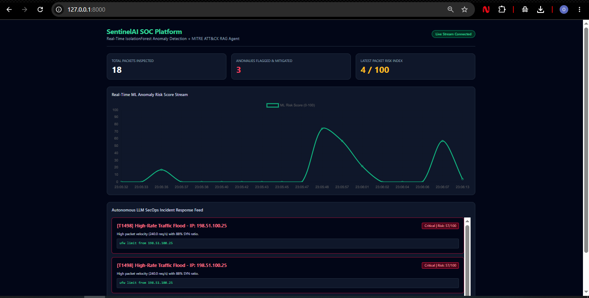

<div align="center">

# 🛡️ SentinelAI: Autonomous AI-Driven SOC & Threat Intelligence Platform

**Real-Time Unsupervised Anomaly Detection • MITRE ATT&CK® RAG Mapping • Autonomous LLM Incident Triage**

[](https://www.python.org/)
[](https://fastapi.tiangolo.com/)
[](https://scikit-learn.org/)
[](https://openai.com/)
[](https://attack.mitre.org/)

</div>

---

## 📌 Executive Summary (The Problem & Solution)

Traditional Security Operations Centers (SOCs) suffer from **static signature blindness** and **analyst alert fatigue**—relying on rigid firewall rules that miss zero-day behavioral anomalies and require slow manual investigation.

**SentinelAI** solves this by acting as an **Autonomous Tier-1/Tier-2 SOC Analyst**. It ingests live network flow telemetry, isolates behavioral anomalies in milliseconds using unsupervised Machine Learning (`IsolationForest`), maps threat patterns to the **MITRE ATT&CK® framework** via a vector similarity **RAG Engine**, and synthesizes an actionable **Root Cause Analysis (RCA)** alongside an executable Linux firewall mitigation command (`iptables` / `ufw`).

### 📊 Key Engineering Highlights
* **Sub-10ms Anomaly Scoring:** Pre-trained `StandardScaler` + `IsolationForest` pipeline evaluating 5-dimensional network telemetry vectors in real time.
* **Zero-Latency Streaming UI:** Full-duplex **FastAPI WebSockets** (`/ws/dashboard`) pushing live telemetry and Chart.js risk streams without HTTP polling overhead.
* **100% Uptime Hybrid AI Architecture:** Combines OpenAI LLM reasoning with a deterministic SecOps rule-synthesis fallback, ensuring uninterrupted incident response even during external API outages or rate limits.
* **Pure-Python Vector RAG Engine:** Engineered with `TfidfVectorizer` and `cosine_similarity` (`NumPy`/`Scikit-Learn`) to eliminate heavy C++ build dependencies (`hnswlib`), ensuring instant cross-platform deployment across Windows, Linux, and bleeding-edge Python 3.15 environments.

---

## 🖥️ Live SOC Dashboard Preview



* **Top Telemetry Cards:** Live packet counter, mitigated anomaly tally, and normalized real-time Risk Index (`0–100`).
* **Real-Time Risk Stream:** Dynamic Chart.js time-series visualization tracking behavioral anomalies as they spike above baseline traffic.
* **Autonomous Incident Feed:** Live cards displaying the matched **MITRE ATT&CK ID**, **Severity Badge**, **Source IP**, **AI Root Cause Analysis**, and copy-ready **Firewall Block Rule**.

---

## 🏗️ System Architecture & Data Pipeline

```text
[ Live Network Traffic / Multi-Vector Attack Simulator ]
                          │
                          ▼  POST /api/v1/ingest (JSON Telemetry)
┌─────────────────────────────────────────────────────────────────────────┐
│                         FastAPI Async Backend                           │
│                                                                         │
│  ┌───────────────────────────────────────────────────────────────────┐  │
│  │ 1. Unsupervised ML Engine (ml_engine.py)                          │  │
│  │    • StandardScaler + IsolationForest                             │  │
│  │    • Computes decision_function() ➔ Normalized Risk Score (0-100) │  │
│  └──────────────────────────────┬────────────────────────────────────┘  │
│                                 │ (If Anomaly Flagged: Prediction == -1)│
│                                 ▼                                       │
│  ┌───────────────────────────────────────────────────────────────────┐  │
│  │ 2. ThreatIntel RAG Engine (rag_engine.py)                         │  │
│  │    • Semantic Feature Expansion + TF-IDF Vectorization            │  │
│  │    • Cosine Similarity Search against MITRE ATT&CK Knowledge Base │  │
│  └──────────────────────────────┬────────────────────────────────────┘  │
│                                 │ (MITRE Context + Raw Telemetry)       │
│                                 ▼                                       │
│  ┌───────────────────────────────────────────────────────────────────┐  │
│  │ 3. Autonomous SecOps Agent (secops_agent.py)                      │  │
│  │    • Synthesizes Root Cause Analysis (RCA) & Severity             │  │
│  │    • Generates Automated Mitigation Command (iptables / ufw)      │  │
│  └──────────────────────────────┬────────────────────────────────────┘  │
└─────────────────────────────────┼───────────────────────────────────────┘
                                  │
         ┌────────────────────────┴────────────────────────┐
         ▼ (SQLite Persistence)                            ▼ (WebSocket Broadcast)
[ incidents.db Audit Log ]                 [ Real-Time Browser Dashboard (/ws/dashboard) ]
```

---

## 🧠 Key Engineering Decisions & Trade-Offs

1. **Why Unsupervised Learning (`IsolationForest`) instead of Supervised Classification?**
   In production cybersecurity, labeled datasets for novel or zero-day attacks are rarely available in advance. `IsolationForest` learns the baseline geometry of normal traffic and isolates statistical outliers across multi-dimensional features without requiring labeled attack signatures.
2. **Why TF-IDF + Cosine Similarity for Threat RAG instead of C++-bound Vector DBs?**
   Traditional local vector databases require C++ compilation (`hnswlib` / Visual C++ Build Tools) that frequently break on newer Python runtimes. Implementing semantic query expansion with Scikit-Learn's `TfidfVectorizer` and NumPy `cosine_similarity` delivers sub-millisecond retrieval across MITRE ATT&CK tactics with zero native compilation bottlenecks.
3. **Why Graceful LLM Degradation?**
   Security tooling cannot fail if a cloud LLM provider experiences downtime or quota exhaustion. `secops_agent.py` implements an automatic fallback mechanism that switches seamlessly between OpenAI's API and deterministic local threat synthesis.

---

## 🎯 Threat Coverage (MITRE ATT&CK® Matrix)

| MITRE Technique ID | Attack Classification | Behavioral Telemetry Signature | Default Severity | Automated Mitigation Output |
| :--- | :--- | :--- | :--- | :--- |
| **T1110** | Brute Force / Credential Stuffing | `failed_logins > 10` targeting auth endpoints | 🔴 **High** | `iptables -A INPUT -s <IP> -p tcp --dport 22,443 -j DROP` |
| **T1046** | Network Service Discovery (Port Scan) | `ports_scanned > 15` with low payload size | 🟠 **Medium** | `ufw deny from <IP> to any` |
| **T1498** | Network Denial of Service (SYN Flood) | `request_rate > 150/s` & `syn_flag_ratio > 0.70` | 🚨 **Critical** | `iptables -A INPUT -s <IP> -p tcp --syn -j DROP` |
| **T1190** | Exploit Public-Facing Application | `avg_payload_kb > 25 KB` (SQLi / RCE buffer spike) | 🚨 **Critical** | `iptables -A INPUT -s <IP> -j DROP` |
| **T1041** | Exfiltration Over C2 Channel | Sustained high outbound payload with moderate rate | 🔴 **High** | `ufw reject out to <IP>` |

---

## 🔌 REST & WebSocket API Reference

| Method | Endpoint | Description |
| :--- | :--- | :--- |
| `GET` | `/` | Serves the real-time SentinelAI SOC Web Dashboard (`index.html`). |
| `POST` | `/api/v1/ingest` | Ingests a network flow telemetry packet, runs ML + RAG + Agent triage, logs to SQLite, and broadcasts to connected WebSocket clients. |
| `GET` | `/api/v1/incidents` | Returns historical flagged security incidents from `incidents.db`. |
| `WS` | `/ws/dashboard` | Full-duplex WebSocket stream pushing real-time packet scores and incident response cards. |

### Sample Payload (`POST /api/v1/ingest`)
```json
{
  "source_ip": "185.220.101.42",
  "request_rate": 240.5,
  "failed_logins": 2,
  "avg_payload_kb": 1.8,
  "ports_scanned": 3,
  "syn_flag_ratio": 0.92
}
```

---

## 📂 Repository Structure

```text
sentinel-ai-soc/
├── models/
│   └── anomaly_pipeline.joblib  # Serialized StandardScaler + IsolationForest pipeline
├── static/
│   ├── index.html               # Real-time SOC frontend (WebSockets + Chart.js)
│   └── dashboard-preview.png    # UI screenshot for documentation
├── main.py                      # FastAPI application, endpoints & WebSocket manager
├── ml_engine.py                 # IsolationForest training, inference & risk scoring
├── rag_engine.py                # MITRE ATT&CK TF-IDF + Cosine Similarity RAG engine
├── secops_agent.py              # LLM & deterministic SecOps incident triage generator
├── simulate_traffic.py          # Multi-vector cyberattack & baseline traffic simulator
├── incidents.db                 # SQLite persistent storage for audited incidents
├── requirements.txt             # Production Python dependencies
└── .gitignore                   # Excludes venv, .env secrets, and cache artifacts
```

---

## ⚡ Quick Start (Run Locally in 60 Seconds)

### 1. Clone the Repository & Enter Directory
```bash
git clone [https://github.com/omkarbhalerao19/sentinel-ai-soc.git](https://github.com/omkarbhalerao19/sentinel-ai-soc.git)
cd sentinel-ai-soc
```

### 2. Set Up Virtual Environment & Install Dependencies
```powershell
python -m venv venv
.\venv\Scripts\Activate
pip install -r requirements.txt
```

### 3. (Optional) Configure OpenAI API Key
Create a `.env` file in the root directory to enable live GPT-powered incident synthesis (if omitted, the platform automatically runs in deterministic local SecOps mode):
```env
OPENAI_API_KEY=sk-your-openai-api-key
```

### 4. Launch the FastAPI SOC Server (Terminal 1)
```powershell
uvicorn main:app
```
> 🌐 Open **`http://127.0.0.1:8000`** in your browser to view the live SOC Dashboard.  
> 📘 Interactive Swagger API Docs available at **`http://127.0.0.1:8000/docs`**.

### 5. Start the Live Cyberattack Traffic Simulator (Terminal 2)
```powershell
python simulate_traffic.py
```

---

## 👨‍💻 Author & Contact

**Omkar Bhalerao**  
🎓 *Bachelor of Business Administration in Computer Applications — BBA (CA)*  
 
💼 **Focus Areas:** Cybersecurity Operations (SecOps), AI/ML Engineering, Full-Stack Python Development
